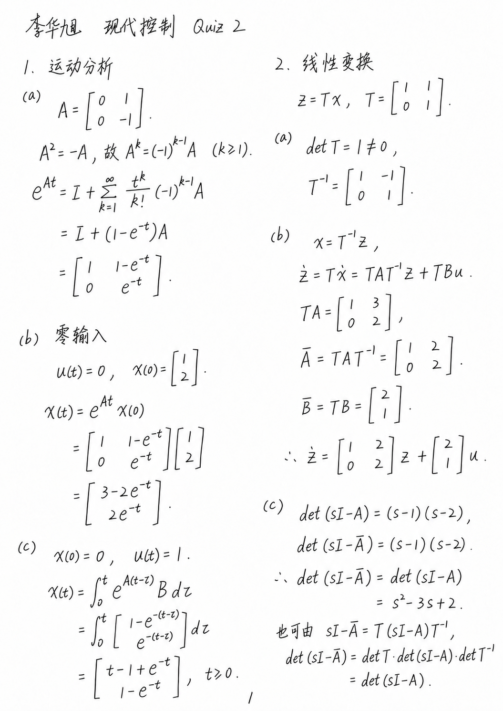
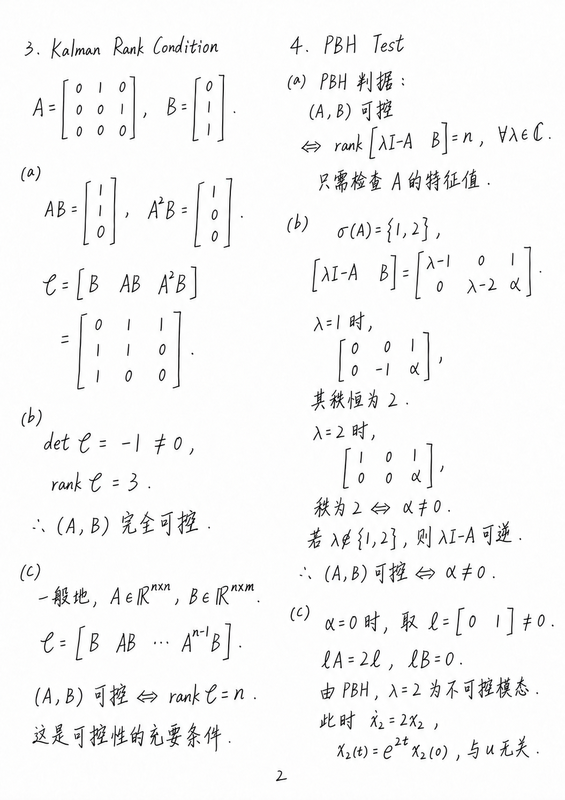
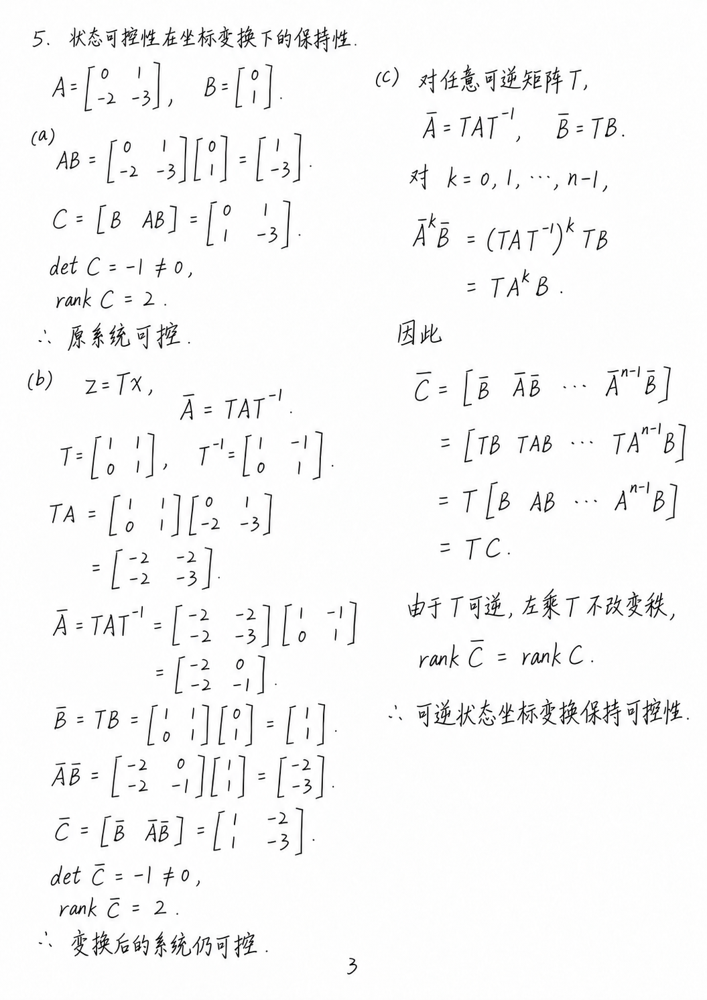
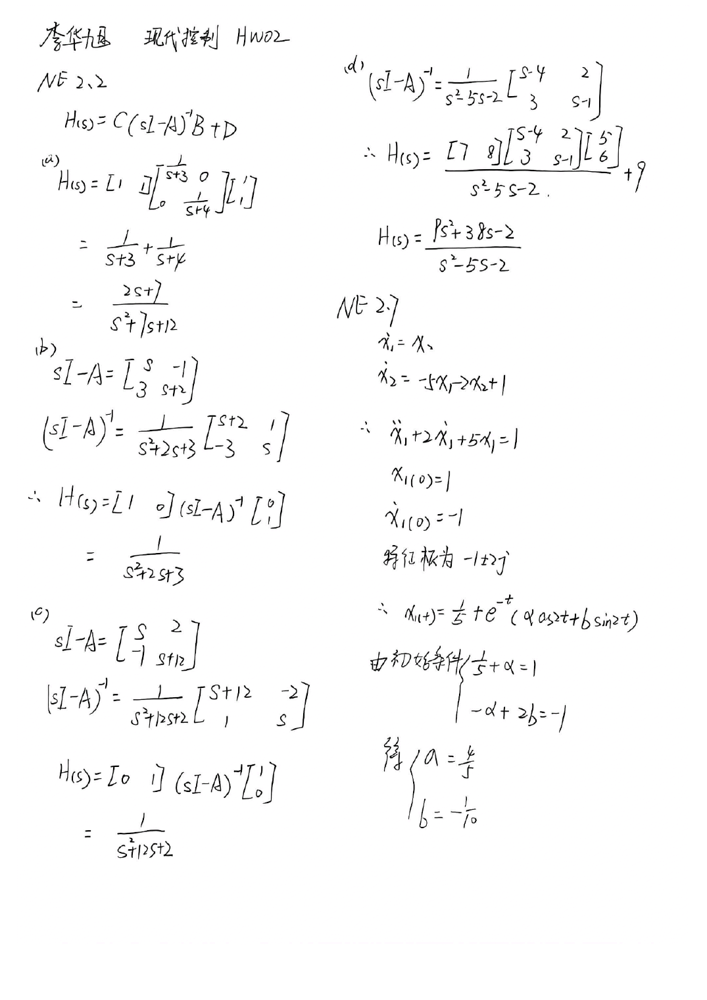
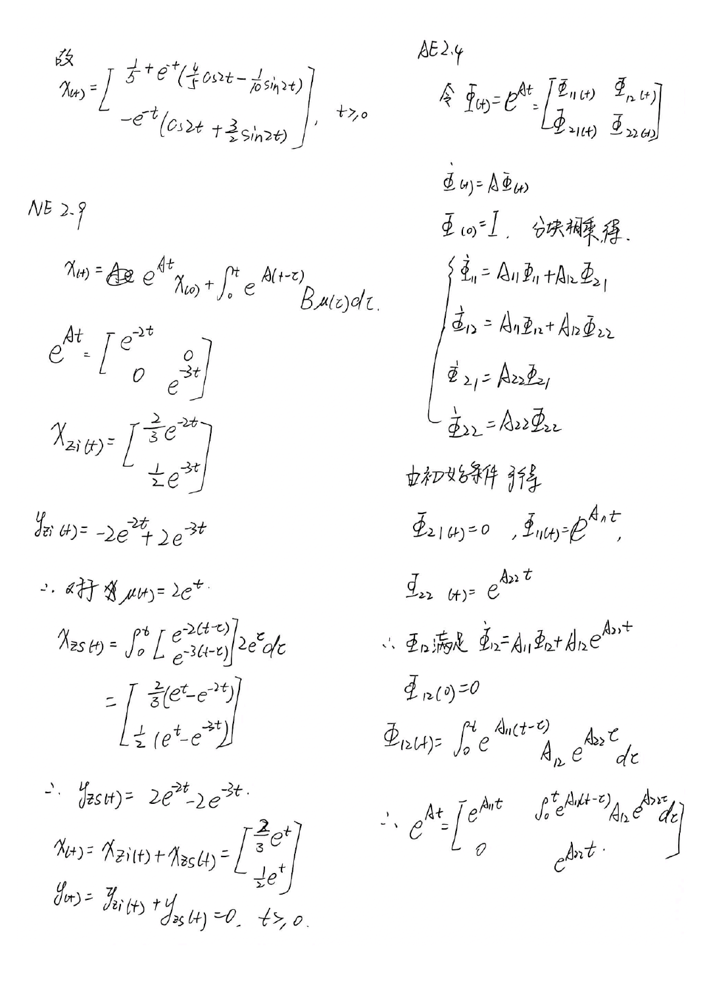

# my-handwriting · 我的字迹手写作业

一个带有个人笔迹参考的 **Codex Skill**：根据题目或现成答案，制作接近本人书写风格的手写页，并合成为 PDF。

两张真实手写扫描样本随技能保存，换对话时可继续使用。支持公式、矩阵、中文说明、证明和图表；科目、题号、语言和版式由本次任务决定。

## 效果展示

以下为此前使用图像生成工具制作的《现代控制 Quiz 2》作答，共 **3 页**。点击图片可查看原图。

| 第 1 页：状态响应与坐标变换 | 第 2 页：Kalman 与 PBH 判据 | 第 3 页：变换下的可控性 |
| --- | --- | --- |
| [](examples/quiz2/page01.png) | [](examples/quiz2/page02.png) | [](examples/quiz2/page03.png) |

**[查看完整手写 PDF](examples/quiz2/quiz2-handwritten.pdf)**

<details>
<summary>展开查看原始个人笔迹参考</summary>

两张参考图来自本人的手写作业扫描，用于提供字形、运笔、间距和纸张风格。

| 参考页 1 | 参考页 2 |
| --- | --- |
|  |  |

</details>

## 快速使用

安装后，在支持此技能和图像生成能力的 Codex 对话中附上题目或答案，并输入：

```text
用 $my-handwriting 完成附件中的作业，导出 PDF。
```

### 直接誊写已有答案

```text
用 $my-handwriting 把附件中的答案整理成手写作业。
保留题号和推导，使用黑笔、白色 A4 纸，导出 PDF。
```

### 调整书写和排版

```text
用 $my-handwriting 完成附件中的物理作业。
字迹随手一些，公式按内容分栏，宽的示意图单独排，导出 PDF。
```

### 加少许自然划改

```text
用 $my-handwriting 誊写这份答案，少许自然划改，导出 PDF。
```

默认只写最终正确内容。要求自然划改时，采用局部落笔笔误：只对写错的字、字母或符号划一道或两三道同向短斜线，再在附近补写正确字符。数量随页面内容自然安排，正确部分保持可读。

### 修改已有页面

```text
用 $my-handwriting 修改附件中的手写 PDF。
把第二页指定的矩阵元素改成正确值，保留其余内容和字迹。
```

## 安装

将仓库克隆到 Codex 的技能目录，并保持文件夹名称为 `my-handwriting`。

### Windows / PowerShell

```powershell
$handwritingSkillRoot = if ($env:CODEX_HOME) {
    Join-Path $env:CODEX_HOME 'skills'
} else {
    Join-Path $env:USERPROFILE '.codex\skills'
}
New-Item -ItemType Directory -Path $handwritingSkillRoot -Force | Out-Null
git clone https://github.com/TongYee325/my-handwriting.git (Join-Path $handwritingSkillRoot 'my-handwriting')
```

### macOS / Linux

```bash
mkdir -p "${CODEX_HOME:-$HOME/.codex}/skills"
git clone https://github.com/TongYee325/my-handwriting.git "${CODEX_HOME:-$HOME/.codex}/skills/my-handwriting"
```

私有仓库需要先配置可访问该仓库的 GitHub 身份。也可以下载仓库 ZIP，将解压后的目录改名为 `my-handwriting`，放入同一技能目录。安装后打开新对话，输入 `$my-handwriting` 调用。

## 工作方式

1. 读取本次题目或答案，整理正确内容并按篇幅分页。
2. 查看随附笔迹样本，以样本为风格参考逐页生成图像。
3. 对照内容核对符号、矩阵、上下标和正文，需要时局部修正。
4. 将选定页图合成 PDF；程序运行结果等已有 PDF 可以顺序追加。

图像由当前环境的 `imagegen` 技能与内置图像生成工具制作。字迹相似度及公式细节受每次生成影响，成品需要逐页核对。单独运行 PDF 脚本时，输入应为已生成的页面图片。

## PDF 组装脚本

需要 Python 和下列依赖：

```bash
python -m pip install -r requirements.txt
```

在仓库根目录，将示例三页合为新 PDF：

```bash
python scripts/assemble_pdf.py --images examples/quiz2/page01.png examples/quiz2/page02.png examples/quiz2/page03.png --output output/quiz2.pdf --title "现代控制 Quiz 2"
```

| 参数 | 用途 |
| --- | --- |
| `--images` | 按给定顺序读入页图；引号包裹的通配符按文件名自然排序。 |
| `--output` | 输出 PDF 路径。 |
| `--append-pdf` | 在手写页后追加现成 PDF，可重复使用。 |
| `--page-size A4` | 默认 A4；也可指定 `Letter`。 |
| `--title` / `--author` | 设置 PDF 标题与作者。 |
| `--overwrite` | 替换已有同名输出。 |

## 文件结构

```text
my-handwriting/
├── SKILL.md                     技能入口与制作流程
├── agents/openai.yaml           Codex 展示信息
├── assets/reference-01.png      真实笔迹参考
├── assets/reference-02.png
├── references/style-profile.md  字迹特征与局部订正规则
├── references/prompting.md      生成、局部编辑与清理提示词
├── scripts/assemble_pdf.py      PDF 组装工具
├── examples/quiz2/              已生成的三页图片与完整 PDF
├── requirements.txt            PDF 组装依赖
└── README.md                    用法与效果展示
```

## 使用自己的笔迹

替换 `assets/reference-01.png` 和 `assets/reference-02.png`，再按新样本调整 `references/style-profile.md` 中的字形、笔压、间距和布局描述。保留资源文件名后，现有技能入口和提示词仍可继续使用。
